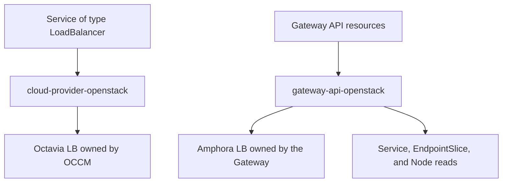

# Gateway API for OpenStack

> [!IMPORTANT]
> This project is pre-alpha and is not ready for production.
> No supported controller environment profile has been published.

gateway-api-openstack implements Kubernetes [Gateway API](https://gateway-api.sigs.k8s.io/) using OpenStack Octavia Amphora load balancers.
It currently supports a limited HTTP profile and aims to become a Conformant implementation for HTTP and terminated HTTPS.
It uses Octavia directly without an in-cluster proxy data plane.

The project lives at [gateway-api-openstack/gateway-api-openstack](https://github.com/gateway-api-openstack/gateway-api-openstack).
Its API group is `gateway-api-openstack.github.io`, and its Go module is `github.com/gateway-api-openstack/gateway-api-openstack`.

## How it works

One Gateway owns one Octavia load balancer and its listeners, pools, members, health monitors, and L7 resources.
The controller reads backend Services, EndpointSlices, and Nodes and manages only its own cloud resources.
The OpenStack Cloud Controller Manager (OCCM) continues to manage Services of type `LoadBalancer` and their cloud resources.

The controller does not adopt existing load balancers, manage tenant network topology, or replace OCCM.
It also does not migrate resources from cloud-provider-openstack's [Octavia Ingress Controller](https://github.com/kubernetes/cloud-provider-openstack/tree/master/docs/octavia-ingress-controller).
The [architecture](docs/design/architecture.md) defines ownership, resource mapping, reconciliation, and recovery.

## Current implementation

The controller uses Gateway API v1.6.1 Standard Channel and supports:

- One HTTP listener and one selected HTTPRoute in the Gateway namespace
- One rule, one backend NodePort Service, and Exact or PathPrefix matching
- At most one exact route hostname
- Eligible worker NodePort members with Local or Cluster traffic policy
- Typed GatewayClass configuration with topology settings fixed for each Gateway
- Optional Floating IP allocation
- Ownership validation, restart recovery, and ordered cleanup

The [class configuration reference](docs/reference/class-configuration.md) describes deployment options and worker selection.
Multiple listeners and routes, HTTPS, ReferenceGrant, and ordinary ClusterIP backends remain unimplemented.
OVN, non-HTTP Route kinds, existing resource adoption, and proxy data planes are outside the current product scope.

## Development status

Phase 3 implementation is complete, with broader validation and release work remaining.
See the [compatibility record](docs/providers/compatibility.md) for completed checks and outstanding evidence.
Development results do not establish general OpenStack support or Gateway API conformance.

The [roadmap](ROADMAP.md) targets complete GATEWAY-HTTP Core support and all declared Extended features.
The [feasibility assessment](docs/design/conformance-feasibility.md) records the Octavia API blockers that must be resolved first.
The [conformance guide](docs/testing-conformance.md) describes the required suite and reporting workflow.

## Getting started

The repository includes Kustomize manifests and a NodePort example for development.
Installation requires an operator-built controller image and a Secret containing OpenStack credentials.
Follow [Getting started](docs/getting-started.md) to install, verify, and remove the controller.
Use the [OpenStack E2E guide](docs/testing-openstack-e2e.md) for reusable traffic, recovery, and cleanup tests.

If finalization stops, keep the controller and its credentials available and follow [operator recovery](docs/operator-recovery.md).
Do not remove finalizers to bypass cleanup.

## Contributing

Start with [CONTRIBUTING.md](CONTRIBUTING.md) for local checks and contribution guidance.
Changes to public APIs, ownership, or recovery contracts follow the [ADR process](docs/design/adr/README.md).
Maintainers preparing artifacts follow the [release procedure](docs/releasing.md).

Project roles are described in [GOVERNANCE.md](GOVERNANCE.md), and the support boundary is in [SUPPORT.md](SUPPORT.md).
GitHub issues and pull requests are the project discussion channels.
This project is independently maintained and is not affiliated with or endorsed by Gateway API, cloud-provider-openstack, or OpenInfra.

## Security

Report vulnerabilities through [SECURITY.md](SECURITY.md), not a public issue.
Participation follows the [code of conduct](code-of-conduct.md).

## License

Licensed under the [Apache License 2.0](LICENSE).
