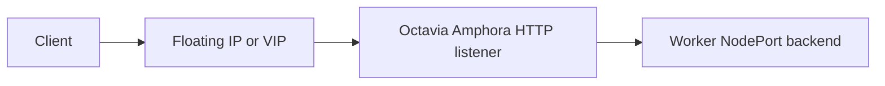

# Architecture

This document describes the constrained HTTP implementation and identifies features that remain planned.
Accepted [architecture decision records](adr/README.md) define the graph writer and class configuration contracts.

## Problem statement

Kubernetes clusters on OpenStack need a Gateway API implementation backed directly by Octavia without coupling Gateway lifecycle to the cloud-provider-openstack Service controller or requiring an in-cluster proxy.
This controller supports only Octavia's Amphora provider.
It currently manages HTTP through Octavia and Neutron.
Terminated HTTPS and Barbican integration are planned.

cloud-provider-openstack's Octavia Ingress Controller is related prior art with a separate API and ownership graph.
This project does not adopt or migrate its resources.

## Product contract

- Users configure routing through Gateway API resources and infrastructure defaults through OpenStackGatewayClassConfig.
- One Gateway owns one Amphora load balancer and its dependent resources.
- One deployment uses one OpenStack cloud, region, authenticated project, and credential scope.
- User-provided NodePort Services supply backends.
- This controller never shares a cloud resource graph with the OpenStack Cloud Controller Manager (OCCM) or another controller.
- Existing OpenStack resources are not adopted.
- Unsupported or unrepresentable behavior is rejected through status.

The current profile supports one HTTP listener, one selected HTTPRoute in the Gateway namespace, one rule, and one Service backend in the route namespace.
It supports an exact hostname with Exact or PathPrefix matching.
Multiple listeners, multiple desired routes, TLS, ReferenceGrant, ClusterIP backends, Pod IP members, requested addresses, and backend policies remain unsupported.

## Design principles

Gateway API defines the public routing and status contract.
Amphora is the only data plane, and unknown environment capabilities are unsupported.
Every Gateway has one complete desired graph and one mutation boundary.
Reconciliation rebuilds that graph after retries, cache changes, and process restarts.

Ownership checks precede mutations, and a converged observation issues no mutating OpenStack call.
Names and cached IDs can locate resources but cannot authorize changes.
The controller uses Gophercloud rather than shelling out to the OpenStack CLI.

### Installed Gateway API version

The controller uses Gateway API v1.6.1 Standard Channel.
It checks installed Gateway API CRD bundle annotations and reports the result through GatewayClass `SupportedVersion`.
A missing required CRD, missing version annotation, or mixed bundle blocks new bindings, provisioning, and repair.
It does not authorize deletion of an existing graph or prevent explicit finalization and cleanup after controller handoff.

Normal reconciliation uses the GatewayClass condition as its cached signal.
Before acquiring a binding or mutating the cloud, the controller checks the live controller selection and a metadata-only view of installed CRDs.
CRD watches and a slow retry on the GatewayClass restore progress after an upgrade.
A dependent object needs its own fallback only when the live check finds a mismatch before the class status changes.

## Ownership contract

### OCCM owns Service load balancers

OCCM owns Services of type `LoadBalancer` and the OpenStack resources it creates for them.
This controller does not use those Services as provisioning sources, create helper LoadBalancer Services, or depend on OCCM finalizers.
It does not manage Ingress, Traefik, Envoy, or another proxy controller.

### This controller owns its Gateway graph

An exact match with `GatewayClass.spec.controllerName` permits new provisioning.
Ownership of a Kubernetes resource covers only this controller's finalizers, binding annotations, and status fields.
Other controllers' fields and HTTPRoute parent status entries are preserved.

The cloud graph contains the Gateway's load balancer, listener, optional Floating IP, and route pools, members, health monitors, L7 policies, and L7 rules.
A resource that stops selecting this controller remains its cleanup responsibility when a durable finalizer or binding records prior ownership.
That responsibility permits cleanup of the recorded graph, not provisioning for the new controller.

Reading a Service, EndpointSlice, Node, class parameter, or OpenStack network does not confer ownership.
The controller does not create tenant networks, subnets, routers, or routes as a side effect of a Gateway.
Secrets, ReferenceGrants, security group policies, and Barbican resources enter the graph only when their future feature contracts are implemented.

### Shared fields require a separate decision

A worker's Neutron port belongs to CAPO, another controller, or the operator.
Attaching a controller-created security group would still modify that foreign port's shared `security_groups` field.
The current implementation does not perform this operation.

A future managed mode needs an accepted ADR and explicit class opt-in.
It must preserve foreign group IDs, validate project and Node-to-port identity, and use Neutron revisions where available.
An ambiguous mapping or concurrent change must stop the update.
Ownership of a security group alone is insufficient authority to change a port.

## Resource graph

| Kubernetes intent | OpenStack representation | Current boundary |
| --- | --- | --- |
| GatewayClass | Controller selection and a class configuration reference | Exact controller ownership and validated parameters. |
| OpenStackGatewayClassConfig | Resolved topology and class health defaults | Cluster-scoped `gateway-api-openstack.github.io/v1alpha1`. |
| Gateway | Amphora load balancer | One per Gateway. |
| Gateway address | Allocated Floating IP or load balancer VIP | Existing addresses are not adopted, and requested Gateway addresses are unsupported. |
| Listener | HTTP listener | One listener. Terminated HTTPS remains planned. |
| HTTPRoute rule and match | Pool, ordered L7 policies, and conjunctive rules | One selected route, rule, and backend with exact hostname and path matching. |
| NodePort backend | Members on eligible worker Node addresses | Pod IP and ClusterIP backends are unsupported. |
| Class health settings | HTTP health monitor for the route pool | Backend-specific policy is deferred. |
| TLS Secret | Future Barbican secret or container | Requires certificate identity, rotation, and deletion design. |
| Frontend security | Octavia-managed security | Referenced VIP security groups are deferred. |
| Backend security | Connectivity managed by the operator | The controller does not modify worker ports or security groups. |

A pool and its children include the exact HTTPRoute identity.
Reusing a Service read within one reconciliation does not share its pool across routes.
Pool sharing would require an ADR covering ownership, protocol and policy compatibility, reconstruction, and deletion after the last reference disappears.
Pools are not shared across Gateways.

## Immutable cloud identity

Ownership uses the authenticated project, stable cluster ID, controller identity, Gateway namespace, name and UID, and resource role.
Route resources also contain the HTTPRoute namespace, name and UID.
The release version is trace metadata, so an ordinary version change does not make an owned resource foreign.

For every mutation plan, the adapter discovers resources within the authenticated project, rejects duplicate candidates, validates the complete identity, and checks surrounding dependencies.
A mismatch returns an ownership conflict and stops mutation.
Recovery repeats discovery rather than trusting cached cloud IDs.
Resource types that cannot expose enough identity for safe recovery remain unsupported.

## Reconciliation model

```text
observe -> build desired graph -> validate -> diff -> mutate -> observe
```

The Kubernetes sources build provider-neutral desired values.
The adapter observes OpenStack, validates the complete relevant graph, calculates a deterministic plan, and executes at most its first mutation.
A later reconciliation observes the result again.
Pure model and diff functions remain separate from API reads and writes.

Creation follows dependencies:

```text
LoadBalancer -> Listener -> Pool -> Member/HealthMonitor -> L7Policy -> L7Rule
```

Deletion checks ownership and follows reverse dependency order.
Already absent owned resources count as deleted.
The controller never uses an unvalidated cascade.

### One writer for each Gateway

[ADR 0001](adr/0001-gateway-graph-writer.md) defines the implemented shared writer.
Gateway and HTTPRoute reconcilers retain validation, binding checkpoints, and status ownership.
Both call `internal/controller/graph.Writer`, which acquires a Gateway UID lock and rebuilds the graph from live Kubernetes inputs.
The sole provider mutation entry point is `ReconcileGatewayGraph`.
`GetGateway` remains read-only.

Each Gateway and route component has an `Ensure`, `Preserve`, or `Delete` disposition.
Route cleanup preserves the Gateway component and deletes only exact detaching fragments.
Whole-Gateway cleanup may remove the entire graph after validation.
A preserved fragment cannot authorize restoring disabled parent traffic.

The route source lists the Gateway namespace through the uncached reader, including bound routes whose ParentRef has disappeared and candidates that can affect selection.
It repeats that inventory before mutation and checks route UIDs and resource versions, then validates the required object revisions, bindings, finalizers, lifecycle, ownership, and API version.
These checks detect observed changes without claiming an atomic Kubernetes snapshot.
Cached indexes drive event mapping, not proof of inventory completeness.

Bound routes require an explicit `Attached` or `Detaching` marker.
The route reconciler makes the applicable status and cleanup checkpoint durable before changing the marker to `Detaching`.
That state survives restart and later spec changes until the owned fragment is absent and its binding can be cleared.
Missing or invalid lifecycle markers block graph work.

A missing Gateway does not erase an HTTPRoute's durable cleanup identity.
A detaching route can still remove its exact child graph with `Gateway=Preserve`.
It cannot recreate or delete Gateway infrastructure.

The writer has no persistent fragment registry or mutation plan.
Its coordinator is process-local, and multiple mutating replicas require leader election.
A restart reconstructs state from Kubernetes bindings and OpenStack identity.

### Component outcomes and administrative repair

A graph call returns a scheduling outcome and separate Gateway and route results.
Errors identify the affected component when known.
A route failure discovered during Gateway reconciliation does not become a Gateway provisioning failure, and a route transition does not clear a still-valid Gateway `Programmed` condition.

The desired load balancer and listener administrative state is enabled.
After validating all relevant fragments, the plan reconciles Gateway prerequisites, deletes detaching fragments, reconciles the attached fragment, enables the listener, and finally enables the load balancer.
It performs only one of these mutations per call.
Immutable topology and identity differences are conflicts, not fields to overwrite.

### Asynchronous operations and backend transitions

Octavia `PENDING_*` blocks mutations and returns bounded progress for a later observation.
Timeouts, retryable failures, rate limits, quota failures, terminal validation, failed resources, and ownership conflicts remain distinct.
A worker does not wait synchronously for an operation that takes minutes to complete.

For a valid backend change, the member plan removes obsolete members before adding replacements.
Unchanged members remain registered.
Replacing every address or NodePort can leave the pool empty between reconciliations, as covered by adapter transition tests.
Neither Octavia `ACTIVE` nor Gateway `Programmed=True` proves backend health or traffic continuity.
A different transition order requires a design that addresses health, mixed traffic, quota, rollback, and revoked backends.

### Kubernetes events and measurements

Manager indexes cover class ownership and parameters, parent Gateways, backend Services, cleanup bindings, and EndpointSlice Services.
Watch handlers use these relationships to enqueue affected objects.
Node mapping filters managed NodePort backends and reuses parent, Service, and endpoint reads within one event.
Service and EndpointSlice mappers read each shared parent index once per invocation while retaining route contenders and direct cleanup requests.
This temporary reuse does not replace the writer's live ownership checks or persist between events.

Predicates react to readiness, schedulability, deletion, relevant labels, and selected addresses.
Cached objects remain immutable.
External drift is observed through a slow resync with stable UID-based jitter, while pending Octavia work uses bounded shorter intervals.

The graph writer measures lock wait, Gateway input, route input, validation, and provider stages with bounded labels.
OpenStack client metrics record request outcomes and latency.
The provider stage includes waits within one call and does not measure full asynchronous convergence or traffic recovery.
Use the [measurement guide](../development-priorities.md#measure-before-increasing-concurrency) before increasing worker concurrency.

## Controller responsibilities

GatewayClass reconciliation checks exact ownership, the API version, typed parameters, and visible topology capabilities.
It reports acceptance and protects the class while managed Gateways reference it.
Read-only capability checks do not prove permission or quota to create a complete graph.
`supportedFeatures` remains empty until the corresponding pinned conformance behavior is covered.

Gateway reconciliation validates listeners and bindings, checkpoints frozen topology, reports Gateway and listener status, and finalizes the recorded graph.
HTTPRoute reconciliation validates parent attachment, selection, matches and backends, checkpoints route lifecycle, and writes its own parent status entries.
The writer reuses those resource packages through small source interfaces and owns the shared mutation boundary.

## Backend connectivity

NodePort is the only implemented member mode.
The controller uses the class-selected Node address type and a user-provided NodePort Service.
It checks readiness, schedulability, address family, Service ports, and EndpointSlice state.

Control plane Nodes are excluded.
`externalTrafficPolicy: Cluster` can use every eligible worker, while `Local` requires a ready endpoint on that worker.
The [class configuration reference](../reference/class-configuration.md#worker-nodeport-members) defines the full eligibility and exclusion-label rules.
The controller does not alter Node labels or create helper Services.

The operator must provide routing and security rules that let Amphora reach NodePorts.
A VIP subnet is not proof of the Amphora source network.
Compatibility evidence must record the traffic policy, IP family, kube-proxy behavior, and topology tested.
Pod IP mode remains deferred until direct reachability, CNI behavior, endpoint conditions, draining, and security have an explicit contract.

## Class configuration and frozen topology

[ADR 0002](adr/0002-class-configuration.md) and the [class configuration reference](../reference/class-configuration.md) define OpenStackGatewayClassConfig.
Its cluster-scoped `v1alpha1` API supplies VIP and member subnet references, Floating IP policy, optional Amphora flavor and availability zone, Node address type, and health monitor settings.
The GatewayClass parameter reference has no namespace.
Credentials, cloud, region, authenticated project, cluster identity, and controller identity remain deployment settings.

A reference selects an ID, exact name, or all specified tags and must resolve to exactly one permitted resource.
VIP and member subnets must belong to the authenticated project.
An allocated Floating IP requires a visible, enabled external network, which can belong to the cloud operator.
The controller checks requested capabilities against visible API and topology evidence and rejects unknown support.
These reads do not modify networks or security groups.

Before the first cloud create, the Gateway binding records the resolved configuration, parameter identity and generation, and an integrity finalizer.
Existing Gateways use that snapshot even when class parameters change or disappear.
The complete topology is required for bound Gateway lifecycle work.
A replacement cloud graph for the same Gateway UID retains it, including health settings and Node addressing.
A new Gateway can use the updated template.

Requested Gateway addresses, `Gateway.spec.infrastructure.parametersRef`, security policy modes, and per-backend health policies remain unsupported.
Future per-Gateway or Direct Policy Attachment APIs need their own scope, precedence, and merge decisions.

## HTTP and HTTPS boundaries

Gateway API matches are alternatives, with conjunctive conditions within each match.
The current path mapping uses ordered Octavia policies and rules.
PathPrefix `/foo` needs an exact `/foo` policy and a `/foo/` prefix policy so that `/foobar` does not match.

The [conformance guide](../testing-conformance.md) records current Core gaps.
The [feasibility assessment](conformance-feasibility.md) identifies Octavia API blockers and designs needed for the broader compiler.
Those designs require accepted decisions before changing ownership or resource mapping.

Terminated HTTPS requires a Barbican identity and certificate lifecycle design, including rotation, rollback, SNI, and safe deletion.
Cross-namespace Service or Secret references also require ReferenceGrant implementation.
An HTTP-only deployment does not need Barbican.

## Failure and recovery

The controller reports standard Gateway API conditions and reasons where available.
`ObservedGeneration` advances only for an evaluated result, and semantic no-op status patches are skipped.
Events and diagnostics contain useful fixed messages without credentials or raw private API bodies.

Finalization retains the durable binding and finalizers until the owned graph is confirmed absent.
A collision or incomplete identity stops mutation rather than triggering adoption or forced finalizer removal.
After an asynchronous transition, timeout, or lost response, recovery observes cloud identity again.

Floating IP discovery searches the authenticated project by complete Gateway identity, including when the load balancer is absent or the address is detached.
If an owned Floating IP is detached or remains after its load balancer disappears, normal provisioning stops without allocating a duplicate address or reconnecting the existing one.
Whole-Gateway deletion can clean up a uniquely owned, fully detached address after validating any remaining load balancer graph.
Duplicate candidates, inconsistent project identity, unexpected associations, and foreign addresses on the VIP port are ownership conflicts.
Route-only cleanup preserves the Gateway's Floating IP, and another user's address is never a cleanup target.

The [ownership audit](ownership-audit.md) remains advisory and read-only.
A report never authorizes mutation, adoption, or finalizer removal.
The [operator recovery guide](../operator-recovery.md) describes investigation of blocked cleanup.

## Security and releases

Use Keystone application credentials and Kubernetes RBAC with only the permissions needed by enabled behavior.
Credentials remain in standard authentication inputs or Secrets and never enter topology bindings, Events, status, or public fixtures.
Worker-port mutation and Barbican access remain separate future privileges.

The [compatibility record](../providers/compatibility.md) describes the current validation scope.
Release evidence and artifact requirements follow the [release workflow](../releasing.md) and [test evidence policy](../reports/README.md).

Control-plane metrics describe reconciliation and API requests.
Traffic and Amphora health come from Octavia or the data plane and must be identified separately in dashboards.

## Explicit data plane boundary



An independently installed proxy may use OCCM and a LoadBalancer Service.
It does not share this controller's Gateway graph.

## Open design decisions

The [ADR index](adr/README.md) records the accepted graph writer and class API decisions.
The following boundaries remain open:

- public artifact registry, promotion, signing, and any future identity migration
- per-Gateway infrastructure parameters and merge semantics
- referenced frontend security and managed changes to worker security groups
- shared resource identity, reference counting, and uninstall behavior
- listener grouping, multiple routes, and global precedence
- weighted and invalid backend behavior
- Barbican identity, certificate rotation, and rollback
- Direct Policy Attachment and backend policy conflict rules
- topology and CNI requirements for Pod IP members

Implementation that changes one of these public or safety contracts requires a design decision and appropriate evidence.
